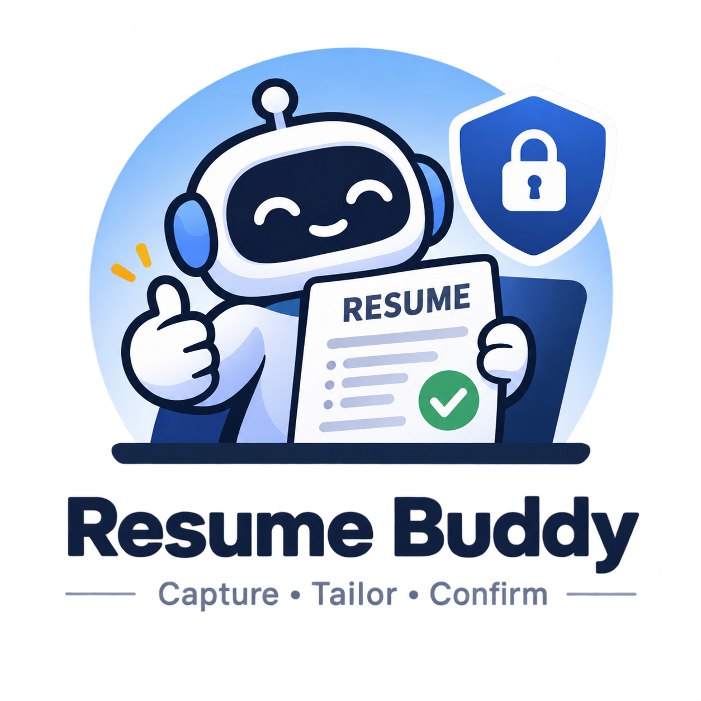
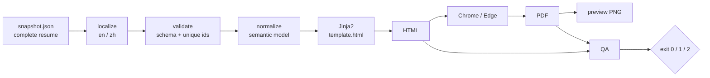

<p align="center">
  
</p>

<h1 align="center">Resume Buddy</h1>

<p align="center"><strong>A local-first Agent Skill for resume management and tailoring.</strong></p>

<p align="center">The AI proposes. You confirm. Your resume stays yours.</p>

<p align="center">
  <a href="README.zh.md">简体中文</a> ·
  <a href="#one-click-start">One-click start</a> ·
  <a href="skills/resume-buddy/SKILL.md">Skill docs</a> ·
  <a href="LICENSE">MIT</a>
</p>

> **AI proposes. You confirm.** Nothing you did not name changes.

## Resume versions getting out of hand?

Writing a resume is hard. Applying to many companies makes it worse: every job gets its own version, edits pile up, and eventually you cannot tell which file is the latest.

Online resume builders add another worry: uploading your work history and contact details to yet another platform.

**Resume Buddy is built for this.**

It is not another online resume builder or template pack. It is an Agent Skill that runs on your machine: use your usual local AI agent to maintain a base resume, analyze a JD, tailor a version, and render a PDF.

## What it does

- **Your data stays yours**: resumes, raw notes, and application records live in a local `data/` directory. No uploads, telemetry, or account.
- **Tailored to the job**: each JD requirement is classified as evidenced, a gap to ask about, or absent. Only real experience is used — nothing is invented.
- **Traceable edits**: the AI shows an old → new diff for named ids and waits for your confirmation before writing.
- **Clean versions**: every application gets its own directory and complete snapshot; the base resume is never overwritten. Each edit creates a new snapshot.
- **Local PDF output**: HTML and PDF are rendered on your machine, with no online resume platform involved.
- **Reviewable applications**: JDs, snapshots, and application records stay local, ready for the agent to analyze whenever you ask.
- **Verifiable**: a synthetic fixture and selftest let a fresh clone validate the rendering pipeline immediately.

## One-click start

You do not need to study the install steps or hand-configure a pile of files.

Open your local AI agent (Claude Code, Codex, OpenCode, DSh, or similar) and send it the prompt below. The agent must be able to run commands and read/write files on your machine; if it can only chat, use the manual install instead.

### One-click prompt

```text
Please install, verify, and initialize Resume Buddy on my machine.

Repository: https://github.com/pzq123456/resumeBuddy

Work through these steps in order and report briefly after each one:

1. Detect my environment: OS, shell, current working directory, and the agent harness you are running in (Claude Code, Codex, OpenCode, DSh, or another).
2. Choose a clone location and clone the repository; ~/resume-buddy is a good default. If it already exists, inspect its git status and local changes first. Do not overwrite or reset anything. Call the clone path RESUME_BUDDY_HOME.
3. Read $RESUME_BUDDY_HOME/README.md, $RESUME_BUDDY_HOME/skills/resume-buddy/SKILL.md, and $RESUME_BUDDY_HOME/skills/resume-buddy/references/renderer.md. Confirm the data layout, install method, and run commands.
4. Install skills/resume-buddy according to the harness's skill convention:
   - Claude Code: ~/.claude/skills/resume-buddy/
   - OpenCode: ~/.config/opencode/skills/resume-buddy/
   - Other harnesses: use the official skill directory. If the harness has no skill support, keep using the clone directly.
   Confirm that SKILL.md is discoverable. If the current session cannot discover it immediately, tell me to restart the session.
5. Check dependencies: Python 3.13+ (uv can provide it; an older system Python is fine if uv works), uv, Chrome or Edge (for PDF), and a system CJK font (only for Chinese output). Report actual versions and paths. If something is missing, explain how to install it; do not install software from untrusted sources.
6. From $RESUME_BUDDY_HOME, run:
   uv run skills/resume-buddy/scripts/render.py --selftest
   Confirm it passes. Run any harness-provided skill-format check as well.
7. Configure the Git guard hook:
   git config core.hooksPath .githooks
   On macOS/Linux, confirm the hook is executable (chmod +x .githooks/pre-commit). On Windows, if Git reports it is not executable, run git update-index --chmod=+x .githooks/pre-commit.
   Confirm that git config --get core.hooksPath prints .githooks.
8. Verify personal-data isolation:
   - git check-ignore -v data/ should show that data/ is ignored.
   - git ls-files data/ should be empty.
   Create data/base/raw/ and data/applications/ if needed. Do not create or modify any real resume content.
9. Print an installation report: RESUME_BUDDY_HOME, skill install path, dependency versions, selftest result, hook status, data directory status, and the next step.

Important constraints:

- All personal resume data must live under $RESUME_BUDDY_HOME/data/. Do not write data into the global skill install directory, and do not treat the skill directory as the data directory.
- Never upload, commit, or transmit personal resume data. Never run git add -f data/.
- Never invent work experience, project results, education, skills, or numbers. Missing information is a question, not content to fill in.
- Do not create or modify real resume content without my explicit confirmation. Before collecting, organizing, confirming, or editing personal data, explain what you will do and wait for my approval.
- Do not change the project architecture or add features.
- If any step cannot be completed automatically, say exactly where you are blocked and what I should do; do not skip it.

After installation and verification, ask whether I want to start building my base resume now, and ask one key question at a time.
```

The agent will complete what it can for the current environment and give you an installation report.

> For later sessions, start the agent in the clone directory or tell it the repository path first; `data/` always lives there.

**Prepare your real experience. The agent handles the rest.**

### Once installed, try saying

- "Build a base resume from the material I provide."
- "Analyze this JD and show me which requirements are evidenced and which are gaps."
- "Tailor this bullet to the role. Show me the diff first; do not edit yet."
- "Looks good — render the English PDF."
- "Review my recent applications with me."

## Manual install

If you prefer to set things up yourself:

### 1. Clone the repository

```bash
git clone https://github.com/pzq123456/resumeBuddy.git
cd resumeBuddy
```

Keep the clone in a stable location, such as `~/resume-buddy`. All personal data will live in that clone's `data/` directory.

### 2. Install the skill

```bash
# OpenCode
mkdir -p ~/.config/opencode/skills/resume-buddy
cp -r skills/resume-buddy/. ~/.config/opencode/skills/resume-buddy/

# Claude Code
mkdir -p ~/.claude/skills/resume-buddy
cp -r skills/resume-buddy/. ~/.claude/skills/resume-buddy/
```

On Windows PowerShell:

```powershell
# OpenCode
$dest = "$env:USERPROFILE\.config\opencode\skills\resume-buddy"
New-Item -ItemType Directory -Force $dest | Out-Null
Copy-Item -Recurse -Force skills\resume-buddy\* $dest

# Claude Code
$dest = "$env:USERPROFILE\.claude\skills\resume-buddy"
New-Item -ItemType Directory -Force $dest | Out-Null
Copy-Item -Recurse -Force skills\resume-buddy\* $dest
```

For other harnesses, use that harness's official skill directory. If it has no skill support, use the clone directly. You can also let the agent handle this step.

> Installing the skill only makes it discoverable. It does not move the data directory. Personal data always stays in the clone's `data/`. Some harnesses need a session restart before they can see a newly installed skill.

### 3. Check requirements

You need:

- Python 3.13+
- [uv](https://docs.astral.sh/uv/)
- Chrome or Edge (for PDF)
- A system CJK font (only for Chinese output)

`uv` reads the repository's `.python-version` and can provision Python 3.13 automatically, so an older system Python usually is not a problem. No Node.js, npm, or npx is required. `uv run` reads the inline PEP 723 dependencies; there is no separate package-install step. On first run, `uv` may need network access to resolve and cache dependencies. Resume content is never uploaded, and rendering works offline once the cache is warm.

### 4. Verify the install

```bash
uv run skills/resume-buddy/scripts/render.py --selftest
```

You should see `selftest PASS`. You can also render the sample resume:

```bash
uv run skills/resume-buddy/scripts/render.py skills/resume-buddy/fixtures/sample.json .tmp/demo --lang en
uv run skills/resume-buddy/scripts/render.py skills/resume-buddy/fixtures/sample.json .tmp/demo --lang zh
```

The fixture is fully synthetic and never touches your personal data.

### 5. Configure the guard hook (recommended)

```bash
# macOS / Linux / Git Bash
chmod +x .githooks/pre-commit

git config core.hooksPath .githooks
git config --get core.hooksPath   # should print .githooks
```

On Windows you can skip `chmod`. If Git reports that the hook is not executable, run `git update-index --chmod=+x .githooks/pre-commit`. This setting only affects the current repository; it does not change your global Git configuration. The hook refuses staged files under `data/`. It is a mistake guard, not a security boundary: `git commit --no-verify` bypasses it, so never run `git add -f data/`.

### 6. Confirm data isolation

```bash
git check-ignore -v data/
git ls-files data/                # should print nothing
```

If `data/` does not exist yet, let the agent create it on first use. Do not write real personal information just to verify the setup.

## How it works



A tailored resume starts as a **complete copy** of `base.json`. Each JD requirement is backed by an id (`EVIDENCED`), turned into a question (`GAP`), or removed (`ABSENT`) — never invented.

`edit.py` writes a new snapshot and rejects missing or duplicate ids, mismatched old text, no-op edits, and changes outside the target bullet. The renderer owns layout; the agent only owns content.

Exit codes: `0` pass, `1` QA error, `2` schema/render error. HTML is byte-stable; PDF content and layout are stable, but bytes may differ.

## Where your data lives

Personal data lives in the gitignored `data/` and `.tmp/` directories:

```text
data/
├── base/
│   ├── raw/                     # verbatim source notes, append-only
│   └── base.json                # long-term base resume
├── applications/
│   └── <YYYY-MM-DD>/
│       └── <slug>/
│           ├── jd.md            # JD text + evidence analysis
│           ├── snapshot-01.json # complete snapshot; edits create 02, 03…
│           └── output/          # HTML / PDF / preview PNG
└── applications.md              # optional application log
```

Nothing personal is committed. The shipped fixture uses fake names, employers, schools, links, and numbers. A `pre-commit` hook refuses staged `data/` paths; it is a mistake guard, not a security boundary.

## Troubleshooting

**The agent cannot find the skill.** Make sure it is installed in the current harness's skill directory, then restart the session. Your data still lives in the clone's `data/`; never install it into the data directory.

**PDF rendering fails.** Confirm that Chrome or Edge is installed. You can also point `CV_EDGE_BIN` at the browser executable.

**Chinese PDF reports a font error.** Install a system CJK font and retry; do not work around the font check by editing the template.

**The hook does not work on Windows.** Confirm that `git config --get core.hooksPath` prints `.githooks`. Git for Windows ships `sh`; run the commands in Git Bash.

**Will my data end up in Git?** `data/` is gitignored. `git check-ignore -v data/` should show the matching rule, and `git ls-files data/` should be empty. Never run `git add -f data/`.

## Limits

HTML and PDF only — no DOCX/ATS output, web fetching, diff UI, lock enforcement, theme selection, or overlay inheritance. Full list in [`SKILL.md`](skills/resume-buddy/SKILL.md) §8.

## Feedback and contributions

The project is open source. Try it, open an issue, or send a PR: https://github.com/pzq123456/resumeBuddy

## Docs

- [Skill instructions](skills/resume-buddy/SKILL.md)
- [Renderer reference](skills/resume-buddy/references/renderer.md)
- [中文说明](README.zh.md)
- [License](LICENSE)
