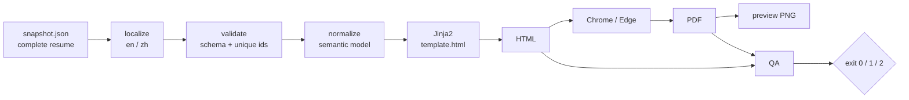

<p align="center">
  
</p>

<p align="center">A local-first Agent Skill for evidence-based resume tailoring.</p>

<p align="center">
  <a href="README.zh.md">简体中文</a> ·
  <a href="skills/resume-buddy/SKILL.md">Skill</a> ·
  <a href="LICENSE">MIT</a>
</p>

> **AI proposes. You confirm.** Nothing you did not name changes.

## What it does

- Maintains a long-term base resume and every tailored version.
- Classifies each JD requirement as `EVIDENCED`, `GAP`, or `ABSENT`.
- Creates a complete snapshot per application, edits one bullet by stable id
  with diff-and-confirm, and renders a deterministic PDF.
- Runs fully offline: no uploads, telemetry, or account.

## How it works



A tailored resume starts as a **complete copy** of `base.json`. Each JD
requirement is backed by an id (`EVIDENCED`), turned into a question (`GAP`),
or removed (`ABSENT`) — never invented. `edit.py` writes a new snapshot and
rejects missing/duplicate ids, mismatched old text, no-op edits, and changes
outside the target bullet. The renderer owns layout; the agent only owns
content.

Exit codes: `0` pass, `1` QA error, `2` schema/render error. HTML is
byte-stable; PDF content and layout are stable, but bytes may differ.

## Install

```bash
# OpenCode
cp -r skills/resume-buddy ~/.config/opencode/skills/

# Claude Code
cp -r skills/resume-buddy ~/.claude/skills/
```

The skill is self-contained Python — no Node.js, npm, or npx is required.
Restart the agent session and ask: *"analyze this job description against my
experience"*.

## Try it

The fixture is fully synthetic, so a fresh clone works immediately:

```bash
uv run skills/resume-buddy/scripts/render.py --selftest
uv run skills/resume-buddy/scripts/render.py skills/resume-buddy/fixtures/sample.json .tmp/demo --lang en
uv run skills/resume-buddy/scripts/render.py skills/resume-buddy/fixtures/sample.json .tmp/demo --lang zh
```

Requires Python 3.13+ and [uv](https://docs.astral.sh/uv/), plus Chrome or
Edge for PDF. Chinese output also needs a system CJK font. No package install
step: `uv run` reads the inline PEP 723 dependencies.

## Privacy

Personal data lives in gitignored `data/` and `.tmp/`:

```text
data/
├── base/                  # raw notes + base.json
├── applications/          # <date>/<slug>/{jd.md,snapshot-*.json,output/}
└── applications.md        # optional application log
```

Nothing personal is committed. The shipped fixture uses fake names, employers,
schools, links and numbers. A `pre-commit` hook refuses staged `data/` paths;
it is a mistake guard, not a security boundary.

## Limits

HTML and PDF only — no DOCX/ATS output, web fetching, diff UI, lock
enforcement, theme selection, or overlay inheritance. Full list in
[`SKILL.md`](skills/resume-buddy/SKILL.md) §8.

## Docs

- [Skill instructions](skills/resume-buddy/SKILL.md)
- [Renderer reference](skills/resume-buddy/references/renderer.md)
- [中文说明](README.zh.md)
- [License](LICENSE)
