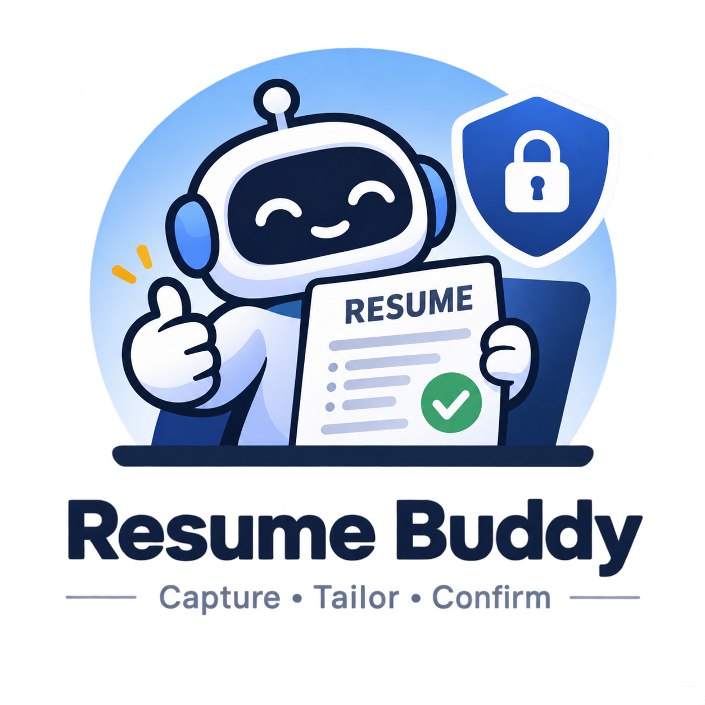
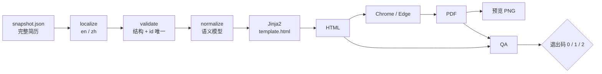

<p align="center">
  
</p>

<p align="center">本地优先、以证据驱动的简历定制 Agent Skill。</p>

<p align="center">
  <a href="README.md">English</a> ·
  <a href="skills/resume-buddy/SKILL.md">Skill</a> ·
  <a href="LICENSE">MIT</a>
</p>

> **AI 只提议，你确认。** 你没有点名的内容，不会被改动。

## 它做什么

- 长期维护一份基础简历，以及每次投递的定制版本。
- 把每条 JD 要求归类为 `EVIDENCED`、`GAP` 或 `ABSENT`。
- 为每次投递生成完整快照，按稳定 id 逐条修改并展示 diff、等待确认，
  最后渲染出确定性的 PDF。
- 完全离线：不上传、不埋点、不需要账号。

## 工作原理



定制简历从 `base.json` 的**完整副本**开始。每条 JD 要求要么有 id 作为
证据（`EVIDENCED`），要么先向你提问（`GAP`），要么确认不具备并删除
（`ABSENT`）——绝不编造。`edit.py` 只写新快照，并拒绝缺失/重复 id、
旧文本不匹配、无实际变化的编辑，以及目标 bullet 之外的改动。渲染器负责
排版，Agent 只负责内容。

退出码：`0` 通过，`1` QA 错误，`2` 校验/渲染错误。HTML 字节级稳定；
PDF 的内容和版式稳定，但字节可能不同。

## 安装

```bash
# OpenCode
cp -r skills/resume-buddy ~/.config/opencode/skills/

# Claude Code
cp -r skills/resume-buddy ~/.claude/skills/
```

这个 skill 是自包含的纯 Python 实现，不需要 Node.js、npm 或 npx。
重启 Agent 会话，然后说：*“对照我的经历分析这份 JD”*。

## 试用

示例数据完全虚构，克隆后即可运行：

```bash
uv run skills/resume-buddy/scripts/render.py --selftest
uv run skills/resume-buddy/scripts/render.py skills/resume-buddy/fixtures/sample.json .tmp/demo --lang en
uv run skills/resume-buddy/scripts/render.py skills/resume-buddy/fixtures/sample.json .tmp/demo --lang zh
```

需要 Python 3.13+ 与 [uv](https://docs.astral.sh/uv/)，以及 Chrome 或
Edge 生成 PDF。中文输出还需要系统中文字体。无需安装 Python 包：
`uv run` 会读取脚本内联的 PEP 723 依赖。

## 隐私

个人数据只保存在被 Git 忽略的 `data/` 和 `.tmp/`：

```text
data/
├── base/                  # 原始素材 + base.json
├── applications/          # <date>/<slug>/{jd.md,snapshot-*.json,output/}
└── applications.md        # 可选的投递记录
```

不会提交任何个人信息。仓库内的示例数据使用虚构姓名、公司、学校、链接和
数字。`pre-commit` 钩子会拒绝暂存的 `data/` 路径；它是防误操作的护栏，
不是安全边界。

## 限制

只输出 HTML 和 PDF——不支持 DOCX/ATS、不联网抓取、没有 diff 界面、没有
lock 强制、没有主题选择、没有 overlay 继承。完整列表见
[`SKILL.md`](skills/resume-buddy/SKILL.md) §8。

## 文档

- [Skill 说明](skills/resume-buddy/SKILL.md)
- [渲染器参考](skills/resume-buddy/references/renderer.md)
- [English README](README.md)
- [许可证](LICENSE)
