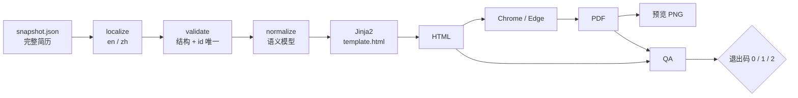

<p align="center">
  
</p>

<h1 align="center">Resume Buddy</h1>

<p align="center"><strong>本地优先的 AI 简历管理与定制 Skill</strong></p>

<p align="center">AI 负责整理和建议，你负责确认。自己的简历，自己做主。</p>

<p align="center">
  <a href="README.md">English</a> ·
  <a href="#一键启动">一键启动</a> ·
  <a href="skills/resume-buddy/SKILL.md">Skill 文档</a> ·
  <a href="LICENSE">MIT</a>
</p>

> **AI 只提议，你确认。** 你没有点名的内容，不会被改动。

## 简历越改越乱？

不知道怎么写简历？投了很多公司，却发现每个岗位的简历版本越来越多；改来改去，最后自己都分不清哪个才是最新版？

想用线上平台，又担心把个人经历、联系方式上传到各种在线简历平台？

**Resume Buddy 就是为这个场景做的。**

它不是又一个在线简历生成器，也不是一套模板。它是一个跑在你本机的 Agent Skill：用你常用的 AI Agent 对话，就能维护基础简历、分析 JD、定制版本、生成 PDF。

## 它解决什么问题

- **数据自己做主**：简历、原始素材和投递记录都保存在本地 `data/`，不上传、不埋点、不需要账号。
- **针对岗位定制**：逐条分析 JD，把要求归类为有证据、待确认、不具备；只结合真实经历调整，不凭空编造。
- **修改有据可查**：AI 先给出 old → new 的 diff，说明改了哪些 id、哪些不能动；你确认后才写入。
- **版本清晰**：每次投递都有独立目录和完整快照，原始简历不会被覆盖；每次修改生成新快照。
- **本地生成 PDF**：HTML/PDF 都在本机渲染，不依赖在线简历平台。
- **投递可复盘**：JD、快照和投递记录留在本地，随时可以让 Agent 帮你统计投递情况、复盘版本差异。
- **可验证**：内置合成 fixture 和 selftest，克隆后即可验证渲染链路。

## 一键启动

不需要手动研究安装步骤，也不需要自己配置一堆文件。

打开你常用的本地 AI Agent（Claude Code、Codex、OpenCode、DSh 等），把下面这段 Prompt 发给它。前提是它能在本机执行命令、读写文件；如果它只有聊天能力，请先参考下方的手动安装。

### 一键启动 Prompt

```text
请帮我在本地安装、验证并初始化 Resume Buddy。

仓库：https://github.com/pzq123456/resumeBuddy

请按以下顺序完成，每完成一步简要汇报结果：

1. 识别当前环境：操作系统、Shell、当前工作目录，以及你正在使用的 Agent Harness（Claude Code / Codex / OpenCode / DSh / 其他）。
2. 选择克隆位置并克隆仓库；建议 ~/resume-buddy。若目录已存在，先检查 git 状态和已有修改，不要覆盖、不要 reset。把克隆目录记为 RESUME_BUDDY_HOME。
3. 阅读 $RESUME_BUDDY_HOME/README.md、$RESUME_BUDDY_HOME/skills/resume-buddy/SKILL.md 和 $RESUME_BUDDY_HOME/skills/resume-buddy/references/renderer.md，确认数据目录、安装方式和运行命令。
4. 按当前 Harness 的 Skill 规范安装 skills/resume-buddy：
   - Claude Code：~/.claude/skills/resume-buddy/
   - OpenCode：~/.config/opencode/skills/resume-buddy/
   - 其他 Harness：使用其官方 Skill 目录；若该 Harness 不支持 Skill，保留仓库直接使用即可。
   安装后确认 SKILL.md 可被发现；若当前会话无法立即发现，告诉我需要重启会话。
5. 检查依赖：Python 3.13+（可由 uv 自动提供；系统 Python 较旧但 uv 可用也算通过）、uv、Chrome 或 Edge（生成 PDF）、系统中文字体（仅中文输出需要）。报告实际版本和路径；缺失时说明安装方式，不要擅自安装来源不明的软件。
6. 在 $RESUME_BUDDY_HOME 下运行：
   uv run skills/resume-buddy/scripts/render.py --selftest
   确认 PASS；如 Harness 提供 Skill 格式校验命令，也一并运行。
7. 配置 Git 防误提交钩子：
   git config core.hooksPath .githooks
   在 macOS/Linux 上确认钩子有执行权限（chmod +x .githooks/pre-commit）；Windows 上如提示不可执行，运行 git update-index --chmod=+x .githooks/pre-commit。
   确认 git config --get core.hooksPath 输出 .githooks。
8. 确认个人数据隔离：
   - git check-ignore -v data/ 应显示 data/ 已被忽略。
   - git ls-files data/ 应没有输出。
   按需创建 data/base/raw/ 和 data/applications/，不要创建或修改任何真实简历内容。
9. 输出安装报告：RESUME_BUDDY_HOME、Skill 安装路径、依赖版本、selftest 结果、hook 状态、data 目录状态，以及下一步如何开始。

重要约束：

- 所有个人简历数据必须保存在 $RESUME_BUDDY_HOME/data/ 下。不要把数据写进全局 Skill 安装目录，也不要把 Skill 目录当成数据目录。
- 不要上传、提交或发送任何个人简历数据；不要执行 git add -f data/。
- 不要编造我的工作经历、项目成果、学历、技能或数字；缺失信息应提问，而不是补全。
- 不要擅自创建或修改真实简历内容。采集、整理、确认和修改个人数据前，先向我说明并等待确认。
- 不要修改项目架构，不要自行增加功能。
- 如果某一步无法自动完成，明确告诉我卡在哪里、需要我做什么，不要跳过。

完成安装和验证后，先问我是否现在开始建立基础简历，并一次只问一个关键问题。
```

发送后，Agent 会按当前环境完成能自动完成的步骤，并给你一份安装报告。

> 以后使用时，建议在克隆目录中启动 Agent，或在新会话里先告诉它仓库路径；`data/` 始终保存在这个目录下。

**你只需要准备好自己的真实经历，剩下的交给 Agent。**

### 安装完成后可以这样说

- “根据我提供的材料，帮我建立一份基础简历。”
- “分析这份 JD，标出哪些要求有证据、哪些是缺口。”
- “把这条经历改得更贴近岗位，先给我看 diff，不要直接改。”
- “确认无误，生成英文版 PDF。”
- “帮我复盘最近的投递记录。”

## 手动安装

如果你不想让 Agent 代劳，也可以手动完成。

### 1. 克隆仓库

```bash
git clone https://github.com/pzq123456/resumeBuddy.git
cd resumeBuddy
```

建议把仓库放在固定位置，例如 `~/resume-buddy`。后续所有个人数据都保存在这个仓库的 `data/` 下。

### 2. 安装 Skill

```bash
# OpenCode
mkdir -p ~/.config/opencode/skills/resume-buddy
cp -r skills/resume-buddy/. ~/.config/opencode/skills/resume-buddy/

# Claude Code
mkdir -p ~/.claude/skills/resume-buddy
cp -r skills/resume-buddy/. ~/.claude/skills/resume-buddy/
```

Windows PowerShell：

```powershell
# OpenCode
$dest = "$env:USERPROFILE\.config\opencode\skills\resume-buddy"
New-Item -ItemType Directory -Force $dest | Out-Null
Copy-Item -Recurse -Force skills\resume-buddy\* $dest

# Claude Code
$dest = "$env:USERPROFILE\.claude\skills\resume-buddy"
New-Item -ItemType Directory -Force $dest | Out-Null
Copy-Item -Recurse -Force skills\resume-buddy\* $dest
```

其他 Harness 请使用其官方 Skill 目录；如果它不支持 Skill，直接在克隆目录中使用即可。也可以把安装这一步交给 Agent 代劳。

> Skill 安装只是让 Agent 能发现它，不会移动数据目录。个人数据始终在克隆仓库的 `data/` 下。部分 Harness 需要重启会话后才能发现新安装的 Skill。

### 3. 检查环境

需要：

- Python 3.13+
- [uv](https://docs.astral.sh/uv/)
- Chrome 或 Edge（生成 PDF）
- 系统中文字体（仅中文输出需要）

`uv` 会读取仓库的 `.python-version`，必要时自动准备 Python 3.13，所以系统 Python 较旧通常不影响使用。不需要 Node.js、npm 或 npx。`uv run` 会读取脚本内联的 PEP 723 依赖，无需单独安装 Python 包。首次运行时 `uv` 可能需要联网解析并缓存依赖；简历内容不会被上传，依赖缓存完成后即可离线渲染。

### 4. 验证安装

```bash
uv run skills/resume-buddy/scripts/render.py --selftest
```

看到 `selftest PASS` 即可。还可以渲染示例简历：

```bash
uv run skills/resume-buddy/scripts/render.py skills/resume-buddy/fixtures/sample.json .tmp/demo --lang en
uv run skills/resume-buddy/scripts/render.py skills/resume-buddy/fixtures/sample.json .tmp/demo --lang zh
```

示例数据完全虚构，不会接触你的个人数据。

### 5. 配置防误提交钩子（推荐）

```bash
# macOS / Linux / Git Bash
chmod +x .githooks/pre-commit

git config core.hooksPath .githooks
git config --get core.hooksPath   # 应输出 .githooks
```

Windows 下可以跳过 `chmod`；如果 Git 提示钩子不可执行，运行 `git update-index --chmod=+x .githooks/pre-commit`。该设置只影响当前仓库，不会改动全局 Git 配置。钩子会拒绝暂存 `data/` 下的文件。它只是防误操作的护栏，不是安全边界：`git commit --no-verify` 可以绕过，所以仍然不要 `git add -f data/`。

### 6. 确认数据隔离

```bash
git check-ignore -v data/
git ls-files data/                # 应该没有输出
```

`data/` 不存在时，可以在第一次使用时让 Agent 创建；不要为了验证而写入真实个人信息。

## 工作原理



定制简历从 `base.json` 的**完整副本**开始。每条 JD 要求要么有 id 作为证据（`EVIDENCED`），要么先向你提问（`GAP`），要么确认不具备并删除（`ABSENT`）——绝不编造。

`edit.py` 只写新快照，并拒绝缺失/重复 id、旧文本不匹配、无实际变化的编辑，以及目标 bullet 之外的改动。渲染器负责排版，Agent 只负责内容。

退出码：`0` 通过，`1` QA 错误，`2` 校验/渲染错误。HTML 字节级稳定；PDF 的内容和版式稳定，但字节可能不同。

## 数据放在哪里

个人数据只保存在被 Git 忽略的 `data/` 和 `.tmp/`：

```text
data/
├── base/
│   ├── raw/                     # 逐字保存的原始素材，只追加
│   └── base.json                # 长期维护的基础简历
├── applications/
│   └── <YYYY-MM-DD>/
│       └── <slug>/
│           ├── jd.md            # JD 原文 + 证据分析
│           ├── snapshot-01.json # 完整快照；每次修改生成 02、03……
│           └── output/          # HTML / PDF / 预览 PNG
└── applications.md              # 可选：投递记录
```

不会提交任何个人信息。仓库内的示例数据使用虚构姓名、公司、学校、链接和数字。`pre-commit` 钩子会拒绝暂存的 `data/` 路径；它是防误操作的护栏，不是安全边界。

## 常见问题

**Agent 说找不到 Skill？** 确认它安装在当前 Harness 的 Skill 目录，并重启会话。数据仍然在克隆仓库的 `data/`，不要安装到数据目录里。

**PDF 生成失败？** 确认已安装 Chrome 或 Edge。也可以用 `CV_EDGE_BIN` 指向浏览器可执行文件的绝对路径。

**中文 PDF 报字体错误？** 安装系统中文字体后重试；不要通过修改模板来绕过字体检查。

**Windows 下钩子不生效？** 确认 `git config --get core.hooksPath` 输出 `.githooks`。Git for Windows 自带 `sh`，可以在 Git Bash 中执行相关命令。

**数据会不会进 Git？** `data/` 已被 `.gitignore` 忽略；`git check-ignore -v data/` 应显示命中规则，`git ls-files data/` 应为空。不要使用 `git add -f data/`。

## 限制

只输出 HTML 和 PDF——不支持 DOCX/ATS、不联网抓取、没有 diff 界面、没有 lock 强制、没有主题选择、没有 overlay 继承。完整列表见 [`SKILL.md`](skills/resume-buddy/SKILL.md) §8。

## 反馈与贡献

项目开源，欢迎体验、提 Issue 或 PR：https://github.com/pzq123456/resumeBuddy

## 文档

- [Skill 说明](skills/resume-buddy/SKILL.md)
- [渲染器参考](skills/resume-buddy/references/renderer.md)
- [English README](README.md)
- [许可证](LICENSE)
